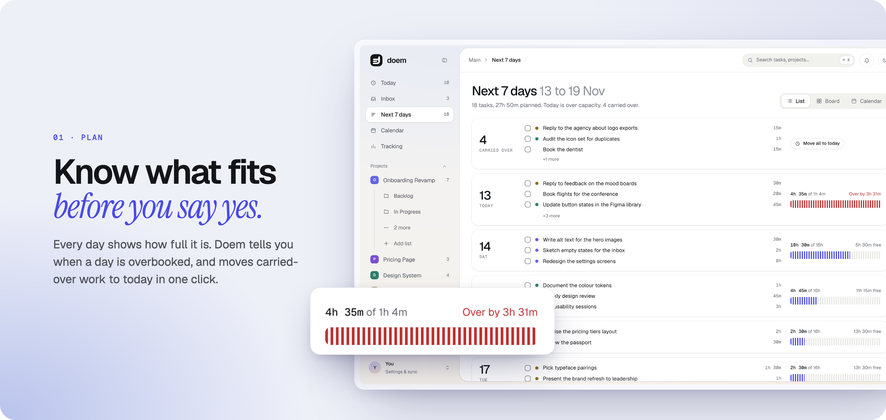
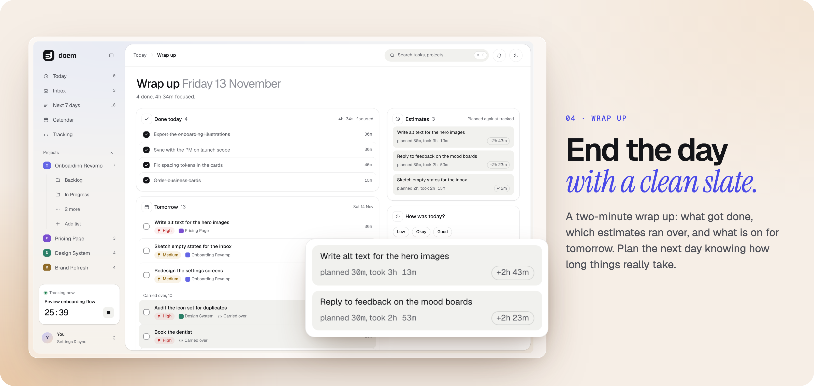
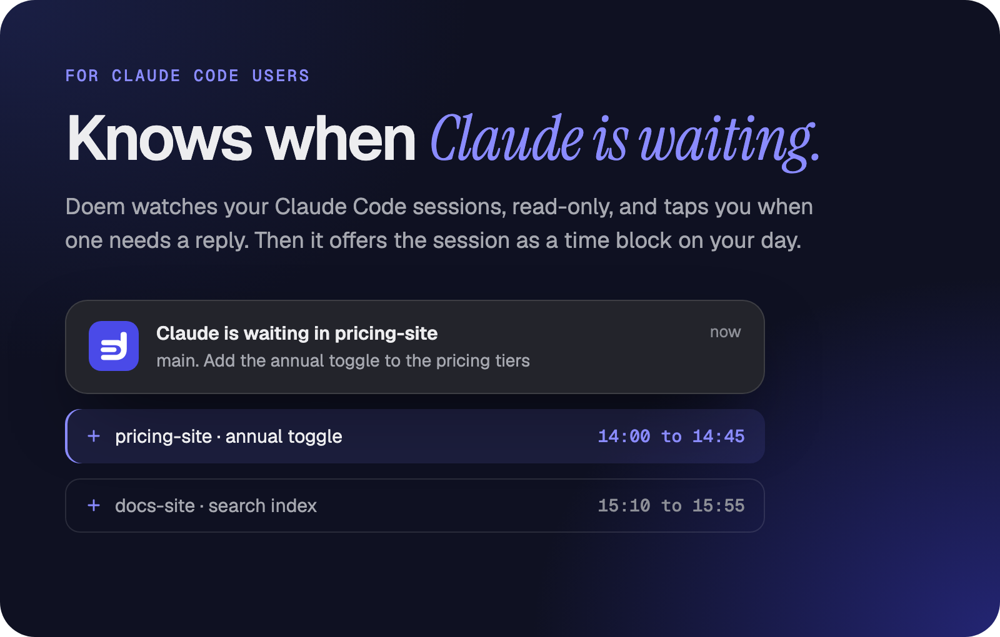
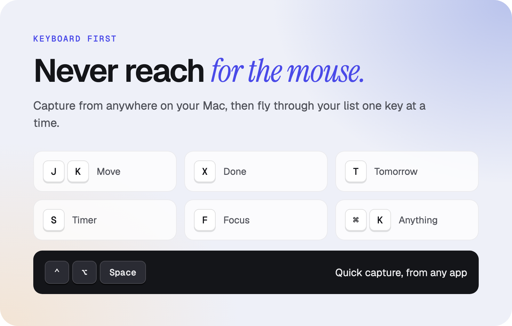

<a href="https://github.com/PurvarajG/doem/releases/latest/download/Doem-latest-arm64.dmg">
  <picture>
    <source media="(prefers-color-scheme: dark)" srcset="docs/media/banners/hero-dark.png">
    
  </picture>
</a>

<p align="center">
  <a href="https://github.com/PurvarajG/doem/releases/latest/download/Doem-latest-arm64.dmg"></a>
</p>

<p align="center">
  <a href="https://github.com/PurvarajG/doem/releases/latest"></a>
  
  <a href="LICENSE"></a>
</p>

<h3 align="center">Your to-do list doesn't know how long things take.<br>Your calendar doesn't know what you need to do.<br>Doem knows both.</h3>

<br>






<table>
  <tr>
    <td width="50%"></td>
    <td width="50%"></td>
  </tr>
</table>

## And everything else you'd want

- **Quick capture from any app.** Control+Option+Space opens a capture window. Type `Call printer 20m tomorrow #project` and it lands with the date, estimate and project filled in.
- **Projects as boards.** Each project opens as a board with its own stages.
- **Focus sessions.** Press F on any task to start one.
- **A timer in the menu bar.** The running task and its time are always one glance away, with an optional nudge when nothing has been tracked for a while.
- **Your iCloud calendar, in the same view.** Events sit beside your tasks, and Doem can publish its tasks as a feed that macOS Calendar subscribes to.
- **Light and dark.** Both themes are designed from scratch, and an optional Dock badge counts today's tasks.
- **No account, no sign-up.** Open it and start. Everything is saved on your Mac.

## Get started

1. **[Download Doem](https://github.com/PurvarajG/doem/releases/latest/download/Doem-latest-arm64.dmg)** and drag it into Applications.
2. The first time, right-click Doem and choose **Open**. You only do this once.

<details>
<summary>Requirements and first-launch help</summary>

<br>

Doem runs on Apple Silicon Macs (M1 and later) with macOS 12 or newer.

The app is not yet signed with an Apple Developer certificate, so macOS asks before the first launch. Right-click Doem in Applications and choose Open, then choose Open in the dialog. If that option does not appear, open System Settings, go to Privacy & Security, find the message about Doem and choose Open Anyway. Later launches open normally.

If you used the app under its earlier name, Tempo, Doem moves your existing data over on first launch.

Doem keeps your data in a local database on your Mac. It contacts the internet only to check once a day for a new version (`api.github.com`), and to read your iCloud calendar if you connect one in Settings.

</details>

<details>
<summary>Keyboard shortcuts</summary>

<br>

In a task list:

| Key | Action |
| --- | --- |
| J / K | Next / previous task |
| X or Space | Mark done |
| T | Move to tomorrow |
| D | Pick a day |
| S | Start or stop the timer |
| F | Start a focus session |
| * | Commit to today |
| E or Enter | Open task |
| Backspace | Move to trash |
| / | Add a task |
| ? | Show shortcuts |

Anywhere in the app:

| Keys | Action |
| --- | --- |
| Cmd K | Search and commands |
| Cmd N | New task |
| Cmd Z | Undo |
| Cmd 0 to 5 | Inbox, Today, Calendar, Tracking, Next 7 days, All tasks |

</details>

<details>
<summary>Build from source</summary>

<br>

Requires Node.js 22 and macOS.

```sh
npm ci
npm run dev            # Next.js dev server on http://localhost:4700
npm run electron:pack  # unpacked app in dist-electron/mac-arm64/Doem.app
npm run electron:build # .dmg for Apple Silicon
```

Other useful scripts: `npm test` (unit and UI tests), `npm run typecheck`, `npm run lint`. Set `PGLITE_DIR` to a folder of your choice to keep a development database apart from the app's own data.

Design documents for the v2 redesign are in [docs/design/v2/](docs/design/v2/), release steps in [docs/release-checklist.md](docs/release-checklist.md), brand assets in [brand/doem/](brand/doem/START-HERE.md) and these README banners in [docs/media/banners/](docs/media/banners/).

</details>

<br>

<a href="https://github.com/PurvarajG/doem/releases/latest/download/Doem-latest-arm64.dmg"></a>

<p align="center"><sub>MIT licensed. See <a href="LICENSE">LICENSE</a>.</sub></p>
