<picture>
  <source media="(prefers-color-scheme: dark)" srcset="docs/media/banners/hero-dark.png">
  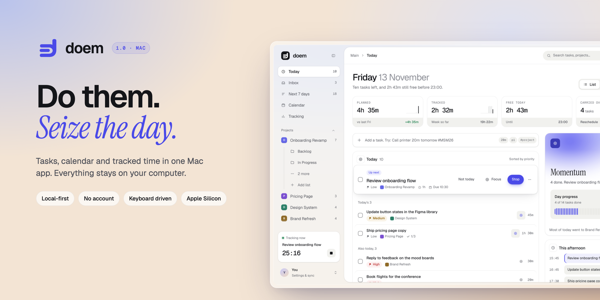
</picture>

<p align="center">
  <a href="https://github.com/PurvarajG/doem/releases/latest/download/Doem-latest-arm64.dmg"></a>
</p>

<p align="center">
  <a href="https://github.com/PurvarajG/doem/releases/latest"></a>
  
  
  <a href="LICENSE"></a>
</p>

<p align="center">
Doem is a Mac app that keeps your tasks, your calendar and your tracked time in one place,<br>with all data stored locally on your computer.
</p>

<br>

<table>
  <tr>
    <td width="50%">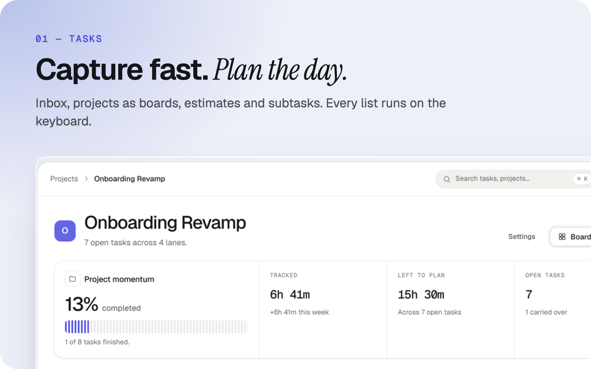</td>
    <td width="50%">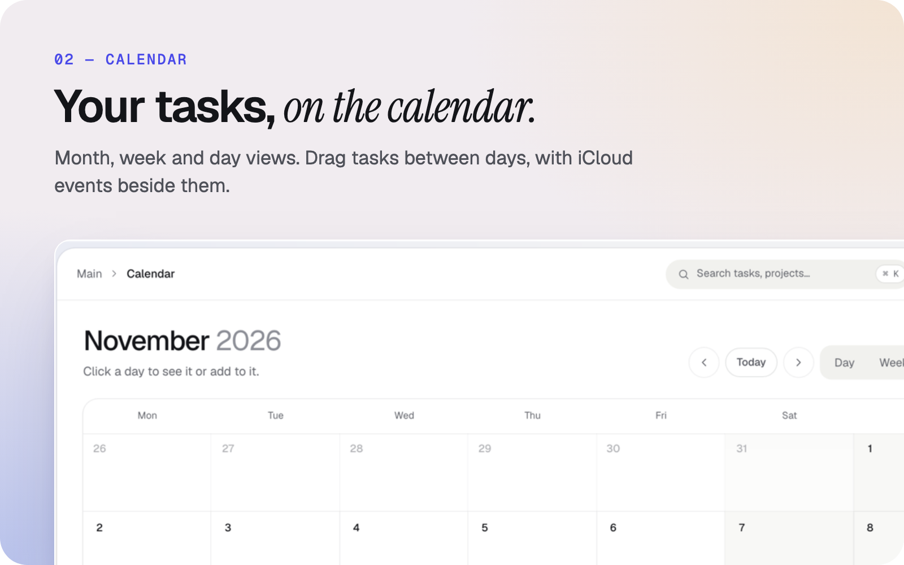</td>
  </tr>
  <tr>
    <td width="50%">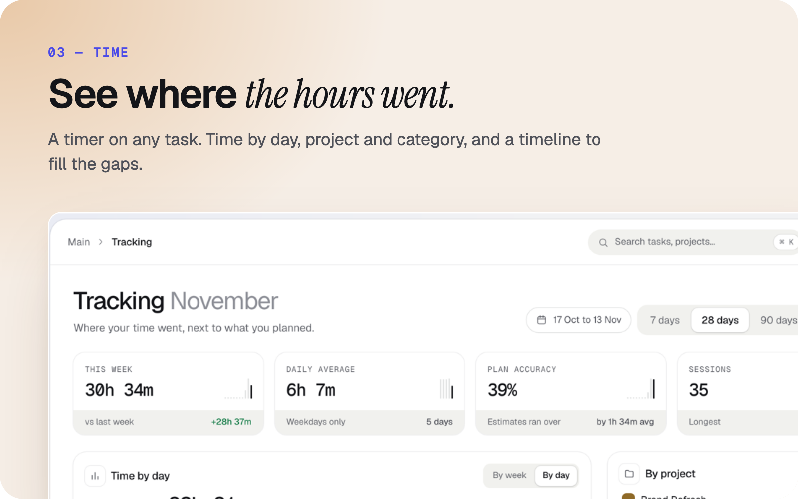</td>
    <td width="50%">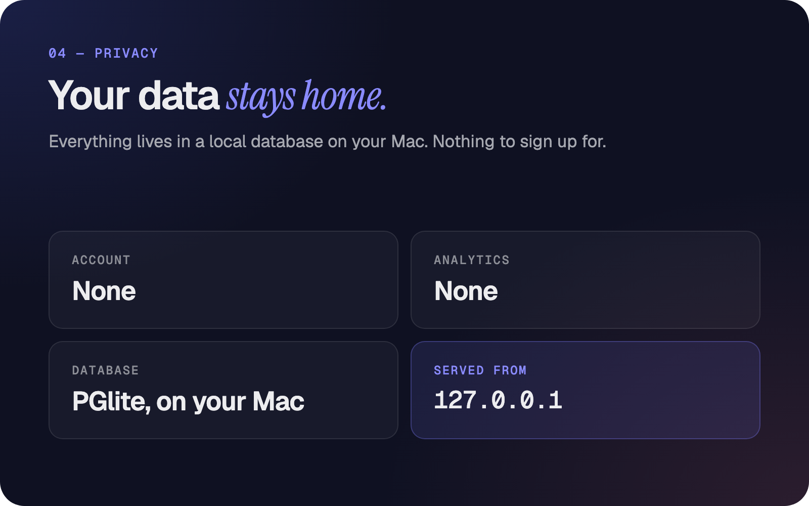</td>
  </tr>
</table>

## What it does

**Tasks.** Capture tasks into an Inbox, give them dates, estimates, subtasks and notes, and organise them into projects. Projects open as a board with stages. Task lists are keyboard driven (see Keyboard shortcuts). A quick-capture window opens from a global shortcut (Control+Option+Space by default, changeable in Settings).

**Today and the week.** Today shows what you have committed to, what is up next, what carried over from earlier days, and what you finished. Next 7 days gives a week-planning grid. All tasks, Completed and Trash hold the rest.

**Calendar.** Month, week and day views. Tasks can be dragged between days. Events from an iCloud calendar can be shown beside your tasks, and Doem can publish its own tasks as a calendar feed that macOS Calendar can subscribe to.

**Time tracking.** Start and stop a timer on any task, or log activities against categories. The Tracking view shows time by day, by project and by category, with a day timeline where gaps can be filled in. A menu bar item shows the running timer. An optional nudge reminds you when nothing has been tracked for a set time.

**Focus.** Start a focus session on a task from the keyboard.

**End of day.** A wrap-up flow checks the day, triages the Inbox, reviews estimate misses and lets you commit tasks for tomorrow.

**Claude Code awareness (optional).** When enabled in Settings, Doem reads Claude Code session files on your Mac, never changing them, to suggest time blocks and to tell you when a session is waiting.

**Appearance.** Light and dark themes, and a Dock badge that shows today's task count (optional).

## Privacy

Doem stores everything in a local PGlite database inside the app's data folder on your Mac. There is no account, no sign-in and no analytics. The app's interface is served from a local web server bound to 127.0.0.1.

The only network requests the app makes are:

1. Once a day, a check for a newer version: a GET request to `api.github.com/repos/PurvarajG/doem/releases/latest`. It is made only by the packaged app, sends no data about you or your tasks, and only reports that a release exists.
2. If you enter an Apple ID and an app-specific password in Settings, a connection to `caldav.icloud.com` to read your iCloud calendar events.

The calendar feed that Doem publishes is served from 127.0.0.1 on your own Mac and does not leave it.

## Install

Doem is built for Apple Silicon Macs (arm64) only. It bundles Electron 43, which supports recent versions of macOS (macOS 12 or later); package.json does not set a separate minimum.

1. Download the .dmg from the link above and drag Doem into Applications.
2. Doem is not signed or notarized, so macOS blocks the first launch. Right-click Doem in Applications and choose Open, then choose Open in the dialog. If that option does not appear, open System Settings, go to Privacy & Security, find the message about Doem and choose Open Anyway.

This is needed once. Later launches open normally.

If you used the app under its earlier name, Tempo, Doem moves your existing data into its own folder on first launch.

## Keyboard shortcuts

<details>
<summary><b>Show all shortcuts</b></summary>

<br>

In a task list:

| Key | Action |
| --- | --- |
| J / K | Next / previous task |
| X or Space | Mark done |
| T | Move to tomorrow |
| D | Pick a day |
| S | Start or stop the timer |
| F | Start a focus session |
| * | Commit to today |
| E or Enter | Open task |
| Backspace | Move to trash |
| / | Add a task |
| ? | Show shortcuts |

Anywhere in the app:

| Keys | Action |
| --- | --- |
| Cmd K | Search and commands |
| Cmd N | New task |
| Cmd Z | Undo |
| Cmd 0 to 5 | Inbox, Today, Calendar, Tracking, Next 7 days, All tasks |

</details>

## Build from source

Requires Node.js 22 and macOS.

```sh
npm ci
npm run dev            # Next.js dev server on http://localhost:4700
npm run electron:pack  # unpacked app in dist-electron/mac-arm64/Doem.app
npm run electron:build # .dmg for Apple Silicon
```

Other useful scripts: `npm test` (unit and UI tests), `npm run typecheck`, `npm run lint`. Set `PGLITE_DIR` to a folder of your choice to keep a development database apart from the app's own data.

## Design documents

The design documents for the v2 redesign are in [docs/design/v2/](docs/design/v2/). The release steps are in [docs/release-checklist.md](docs/release-checklist.md). Brand assets and usage notes are in [brand/doem/](brand/doem/START-HERE.md). The README banners are in [docs/media/banners/](docs/media/banners/).

## Screenshots

<details>
<summary><b>Full-size screenshots</b></summary>

<br>

| | |
| --- | --- |
| 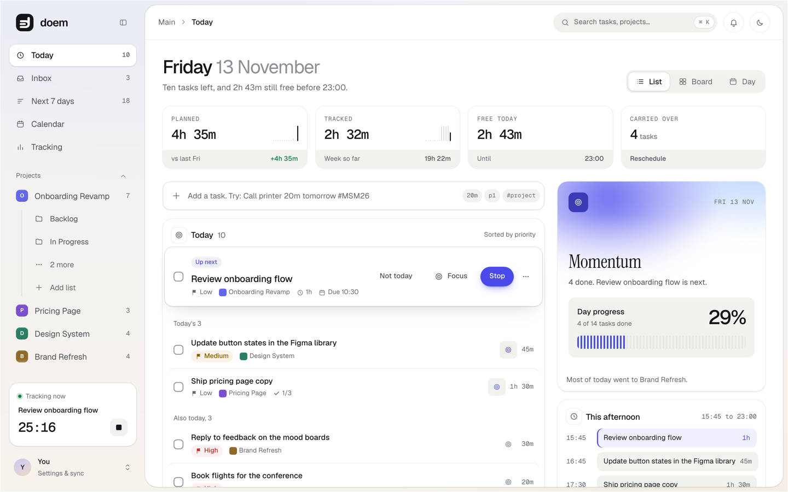 | 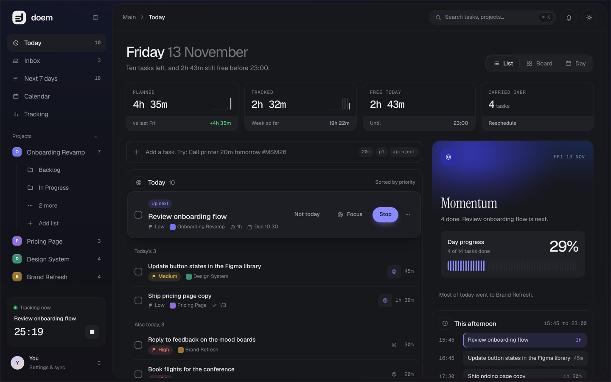 |
| 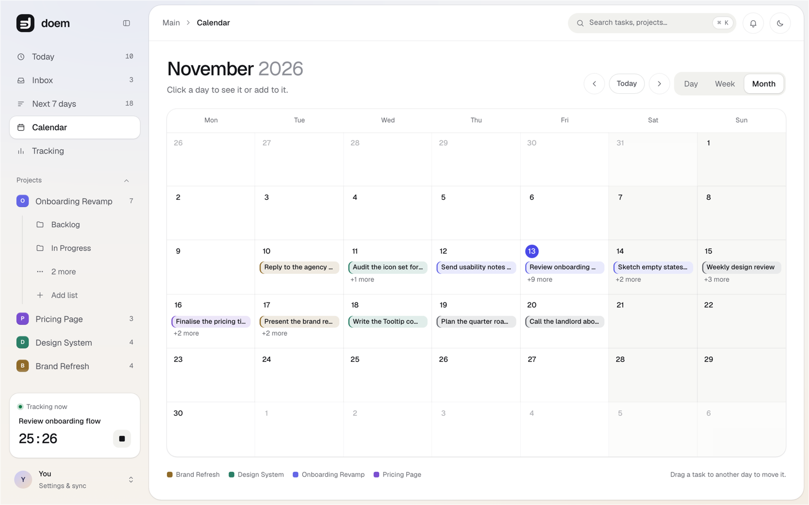 | 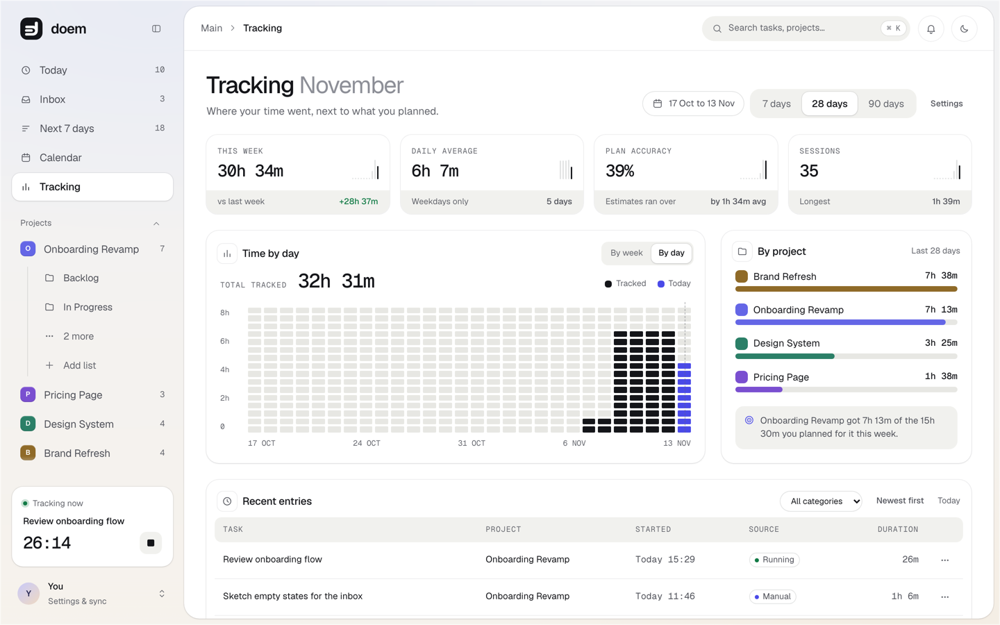 |
| 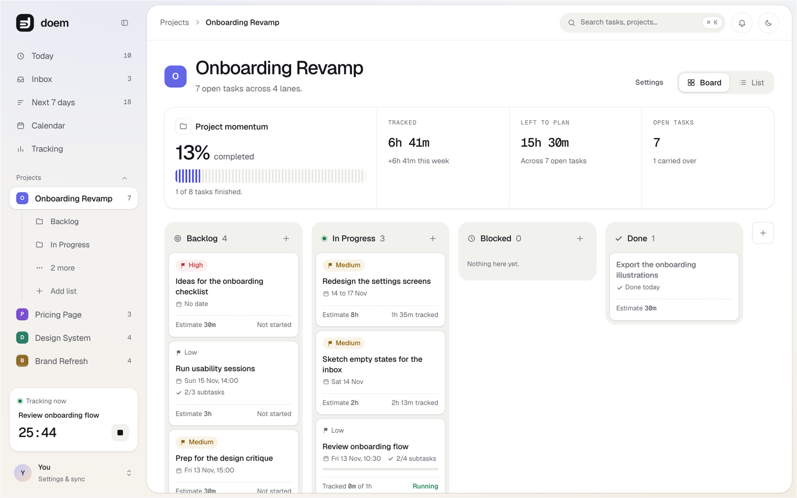 | |

</details>

## Licence

MIT. See [LICENSE](LICENSE).

<br>

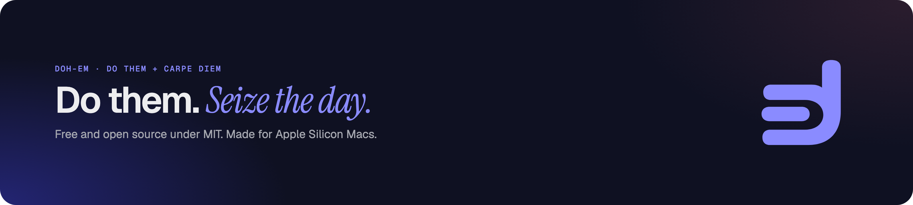
